# DISPATCH_DISSECTION — complete dissection of the foreman dispatcher (Phase 1 of 3)

orch-dispatch-dissect-62c4e5 · 2026-09-20 (all clock times UTC unless marked PT) · read-only, NO changes made.
Builds on `research/DISPATCH_STALL_RCA.md` (wq#2082, cited as RCA). Companions:
`DISPATCH_FIX_RESEARCH.md` (Phase 2), `DISPATCH_REBUILD_SPEC.md` (Phase 3).
Every claim is `file:line` against HEAD `46d57cb` of `/home/lumen/foreman`, or a measurement
reproducible from §9. Raw probe output: `/home/lumen/scratch/dissect/`.

## 0. TL;DR

The loop is no longer the problem. The RCA's layers 1-4 are landed and verified in the running
code (§3, §4). On 2026-09-20: 160 real passes, avg 22.8 s, max 50 s, 1 `lock_busy`, 0 errors. Yet
every pass ends `candidates=120 ready=0 spawned=0`. The stall moved from the LOOP to the SUPPLY and
to the LOCAL RUNG itself:

| # | Flaw | Evidence | Class |
|---|------|----------|-------|
| F1 | **The local rung kills 100% of its own attempts.** `fworker.py:285` frame-gap watchdog = 240 s (sized for cloud TTFT). CPU-only Mac Pros cannot emit a first token on an fworker prompt in 240 s. | 26/26 local attempts in the last 36 h = `HANG`, `killed_reason: inactivity`, `turns: 0`, elapsed 241.4-241.9 s, on ALL three backends. hathor TTFT on a 2k-token prompt (cold) = 142 s. | rung defect |
| F2 | **Macs serve 4096 ctx, manifest claims 40960 / 131072.** No `OLLAMA_CONTEXT_LENGTH` on hathor/nephthys; LiteLLM reaches them via the OpenAI `/v1` shim, which cannot pass `num_ctx`. | `/api/ps` on both: `"context_length":4096, "size_vram":0`. `models.yaml:198,204`. | rung defect |
| F3 | **HANG is charged to the ticket and parks it forever.** `MAX_ATTEMPTS=2` (`fworker.py:291`) -> blocked `UNKNOWN: HANG`; `self_heal` releases only `INFRA_CRASH` (`self_heal.py` docstring, `:274`). Lifetime attempt counter -> `runaway_stuck` (`runaway.py:84-100`), no decay, not per-model. | 22 local tickets blocked `UNKNOWN: HANG`; 14 blocked between 09-20 03:43 and 05:06 alone. 14 open tickets `runaway_stuck`. | accounting flaw |
| F4 | **The router never routes to the two capable Macs.** `nephthys-qwen14b` / `hathor-llama8b` appear in NO `routing:` row (`models.yaml:224-233`); only an explicit `wq --model` pin reaches them. The one local primary (`mechanical-edit -> qwen36-local`) is Isis: 8k ctx, `status: down`, and unreachable right now. | 23 of 120 open tickets local-pinned; 26 of 40 spawns today went to qwen36-local (Isis), 3 to the other two. `lumen_state isis.power_policy`: "The gap was never routing fleet work to it". | supply flaw |
| F5 | **`local_ceiling=12` is one global integer** (`concurrency.py:44`, `config.json`), blind to per-backend capacity: hathor `OLLAMA_NUM_PARALLEL=2`, nephthys unset (1), Isis down = ~3 real slots. 12 workers on 3 slots = queueing = F1. | `_admit_local` `foreman_dispatcher.py:1414-1429`. | no backpressure |
| F6 | **Capability lint (stage 3.7) blocks 44/120 on prose MENTIONS.** Regex over title+detail (`capability_lint.py:464-518`, `:608`): any `/home/lumen/...` string is a required grant; a file directly in `/home/lumen` normalises to the denied parent; the words sudo/reboot/adb/shutdown anywhere = unresolved. Only ~12 of 44 are real secret protection. | §2.3 table. | over-broad gate |
| F7 | **`dispatchable` is an allowlist of skip reasons** (`:158-176`, `:1755`), so every new reason is a false stall until someone remembers to add it. 4th recurrence: `harness_defect_hold` is missing -> `dispatchable_unpooled=1` every pass -> `dispatch_health.py:147` flags a stall -> the recovery ladder ran to exhaustion 09-20 13:11-13:21 (06:11-06:21 PT) on a healthy dispatcher. | `runtime/recover_state.json` rung 3 stopped. | metric flaw |
| F8 | **Terminal states live in `open`.** runaway_stuck, needs_unresolved, capability_denied, lane_unmapped, repo_mismatch, frank_gated, lane_cap are all re-evaluated every 5 min forever (120 `wq show` + 120 lint derivations per pass, 288 passes/day) and re-logged. Nothing moves them out, nothing re-queues them on the EVENT that would unblock them. | 120/120 skipped each pass; 9 MB/day log. | architecture |
| F9 | Two tickets own the spawn budget: wq#1692 and wq#1956 took 24 of today's 40 spawns (3 per rolling 3 h window, `spawn_loop_guard.py:43-44`), each "SUCCESS" with an unreachable deliverable repo (RCA §3.5, still unfixed). | spawn log. | leak |

Answer to the mission's multiple choice (§6.3): it is **(b) + (c) + (e)**. Not (a) per se and not (d):
the pass is 22 s. (e) = the local rung cannot complete a single attempt, and failures are charged to
tickets, so the pool converts itself from `open` to `blocked` within ~10 minutes of any refill.
"Burns bright for a few hours then idles" is exactly: orchestrator releases a batch -> cloud tickets
run and mostly succeed (46 SUCCESS / 62 cloud attempts) -> local tickets all HANG x2 -> blocked ->
remaining pool is 100% structurally gated -> idle until a human re-feeds it.

## 1. The surface: processes, units, files, connections

### 1.1 systemd (as installed, `systemctl cat`)

| unit | cadence / type | runs | notes |
|------|----------------|------|-------|
| `lumen-foreman-dispatch.timer` | `OnUnitActiveSec=20min` overridden to **5 min** by drop-in `timer.d/fast-burn.conf` (Frank 09-10, never committed to `dispatcher/systemd/`), `RandomizedDelaySec=60`, `Persistent=false` | `.service` | the pass driver |
| `lumen-foreman-dispatch.service` | `Type=oneshot`, `TimeoutStartSec=600`, `Nice=5`, PATH drop-in adds `.npm-global/bin` | `foreman_dispatcher.py run --once` | also started ad hoc by `fworker.trigger_refill()` (`harness/fworker.py:3245-3280`, a detached systemd-run that starts the service `--no-block` after every worker exit) and by both recovery ladders |
| `lumen-foreman-health.timer` | 5 min | `dispatch_health.py check` then (drop-in) `dispatch_config_lint.py check` | on N unhealthy passes calls `dispatch_recover.py advance` |
| `dispatch-watchdog.timer` | 4 min | `/home/lumen/bin/dispatch-watchdog.py` | a SECOND, independent stall detector + ladder (journalctl-based: preflight, restart timer, kick), built 09-04; overlaps dispatch_health/recover |
| `lumen-foreman-selfheal.timer` | 10 min, `TimeoutStartSec=120` | `self_heal.py run --once` | own slock scope `foreman-selfheal`, shares DISARM/STOP |
| `lumen-foreman-usaged.service` | `Type=simple`, `Restart=always` | `governor/foreman_usaged.py run` | writes `/home/lumen/foreman/state.json` (`limits`) |
| `lumen-foreman-gate@{nightly,window}` | 05:00 daily / Thu 07:30 | `dispatch_recover.py gate --mode %i` | runs a `--dry-run` pass (takes the same slock) + stamp reproves |
| `lumen-dispatch-lint.timer` | daily 00:08 | config lint | |
| `lumen-foreman-burnrate.timer` | **NOT INSTALLED** | `observed_burn_writer.py` | so `dispatcher/observed_burn.json` does not exist and `burn_rate.load_observed()` always falls back to the 09-10 one-night constants (`burn_rate.py:60`) |

### 1.2 Files and state

| path | writer | reader | what |
|------|--------|--------|------|
| `dispatcher/config.json` | humans, via git | `load_config` reads **HEAD, never the working tree** (`:200-220`, wq#772) | ceilings, tight_mode, burn_rate, 24 lanes (23 enabled) |
| `dispatcher/pacing_config.json` | humans | `pacing.load_config` | `policy: off` since 08-23, so stage 8b is a no-op |
| `dispatcher/state.json` | dispatcher only (`save_state :405`, atomic rename) | dispatcher, `spawn_loop_guard` CLI | `lane_counts` (UTC-day), 8 ntfy dedup ledgers, `spawn_ledger` |
| `dispatcher/runtime/*.json`, `spawn_reserve.db` | health / recover / lint / spawner | same | watchdog state |
| `/home/lumen/foreman/state.json` | usaged | `governor_limits :630`, `router.governor_pressure` | Anthropic pool % + resets_at |
| `governor/floors.json` | humans | router | all floors 0 since 08-23 |
| `research/models.yaml` | humans | router manifest | pools, routing rows, `concurrency: {cloud_max: 3, local_max: 12}` (the dispatcher ignores these two; it uses config.json 10 / 12) |
| `dispatcher.log` | `DecisionLog.emit :304` (+stdout to journald) | health, recover, dashboards, Langfuse emit | one JSON line per decision; ~9 MB/day |
| `_runs/wq<id>/attempt-N.json`, `failure.json` | fworker | `circuit_breaker`, `runaway`, `self_heal`, `spawn_loop_guard` | the authoritative attempt ledger (1000+ dirs) |
| `/home/lumen/agents/work-queue/queue.db` | `wq`, `slock` (same sqlite file, WAL, `BEGIN IMMEDIATE`) | everything | tickets + `slocks` + `slocks_ro` |
| `/home/lumen/autonomy/DISPATCH_DISARM`, `foreman/STOP` | circuit breaker / humans | dispatcher, self_heal, fworker refill | kill switches |
| `harness/fleet-exec-policy.yaml`, `harness/runtime/read_dir_sweep.json` | humans / sweep job | `capability_lint` | allow.read_dirs (30 entries), secret sweep (fail-closed if >48 h stale, `capability_lint.py:508`) |

### 1.3 External calls made inside one pass (all bounded)

- `git show HEAD:config.json` (10 s)
- `slock acquire/release` (30 s)
- `wq list <lane>` x23 (30 s each)
- `wq show` per candidate that passes the lane gates, ~90 (30 s each)
- `lumen_state.py` roster once (15 s, cached `capability_lint.py:219-251`)
- `lumen-run list` (15 s); `wq show` per running unit once per pass (`_PassCtx.unit_counts :1208`)
- `foreman_usaged.py can-dispatch` per cloud model (30 s)
- `router.assign --dry-run` per unpinned ready ticket
- optional live `claude -p` reprove ladder, up to 420 s, UNDER THE LOCK (`:121-124`, `handle_stale_preflight :968`)
- `spawner.dispatch_one` + 2-3 s stagger per spawn (`harness/spawner.py:83-84`, dispatcher `:1552-1553`)
- `ntfy-send` (20 s); Langfuse POST (after release)

## 2. The pass lifecycle and the decision pipeline

### 2.1 Lifecycle, in order (`foreman_dispatcher.py`)

| # | stage | line | can end the pass? |
|---|-------|------|-------------------|
| L0 | `main`: install SIGTERM to SystemExit handler | 1855-1867, 1842-1852 | - |
| L1 | kill switch (DISARM / STOP) | 1778-1781, 417-424 | yes, `halt kill_switch`, rc 0, no lock taken |
| L2 | `load_config` from git HEAD; structural error = abort + ntfy; bad lane = lane disabled (fail-soft) | 1783-1797, 223-294 | yes (`error stage=config`, rc 1) |
| L3 | `slock_acquire` scope `foreman-dispatcher`, holder `foreman-dispatcher:<pid>`, TTL 30 m; dead-holder steal | 1798-1801, 453-470 | yes, `halt lock_busy` |
| L4 | circuit breaker `check_and_trip` (90 min window, >=8 samples, >75% LAUNCH_FAILURE/KILLED/OOM) writes DISARM | 1811-1817, `circuit_breaker.py:58-67,168` | yes, and disarms ALL future passes until a human removes the file |
| L5 | `pass_start` (config sha) | 1818 | - |
| L6 | `scan_candidates`: `wq list <lane> --status open --sort effective` per enabled lane, merged and sorted `(epri, id)` | 784-810 | per-lane errors logged, lane skipped |
| L7 | preamble: `runaway.stuck_ticket_ids`, `harness_defect_ticket_ids`, PSI, pacing cfg, governor limits, burn cfg/observed, `frank_active` | 1650-1716 | PSI `deny` ends the pass (1673-1678) |
| L8 | GATE loop: `_gate_candidate` per candidate, kill switch re-checked each iteration, per-ticket quarantine boundary | 1725-1745, 1231-1400 | kill switch / `lumen_run_unreachable` |
| L9 | ADMIT: `_run_partition("local")` then `("cloud")` | 1749-1753, 1569-1638 | partition-scoped stops only |
| L10 | `_spawn`: preflight stamp gate, stagger, `spawner.dispatch_one`, `lane_counts++`, `record_spawn`, `save_state` | 1513-1566 | - |
| L11 | `pass_end` summary | 1755-1770, 1821 | - |
| L12 | `finally`: `slock_release`, then Langfuse emit | 1826-1835 | - |

### 2.2 The gates, in evaluation order, with today's counts (pass `fdisp-20260920T141053Z-4161920`)

"Local?" = should this gate be able to block a free local ticket.

| order | stage / skip_reason | count | where | trigger | terminal or retryable | Local? | verdict |
|------:|---------------------|------:|-------|---------|-----------------------|--------|---------|
| 1 | lane_policy / `lane_cap` | 16 | 1239-1242, re-checked 1616-1620 | `lane_counts[lane] >= max_per_day` (only `pilot`=3 is a real cap; the rest are 999) | retryable at UTC midnight | yes (deliberate per-lane budget) | KEEP; see F8, 16 tickets re-logged 288x/day |
| 2 | frank_gate / `frank_gated` (human lane) | 13 of 19 | 1243-1252 | lane in `HUMAN_LANES` (139) | terminal for the dispatcher | yes | KEEP; should never be a candidate (filter at scan time) |
| 3 | lane_policy / `lane_unmapped` | 12 | 1253-1257, 1292-1296 | no `LANE_REPO` entry (`router.py:84-125`): `auto` x11, `simpill` x1. `auto` resolves only for repo-sweep tickets carrying a repo hint | terminal until re-laned / mapped | yes, mechanism is right | FIX THE DATA: 6 of the 11 are local-pinned; `simpill` has a config lane but no repo |
| 4 | scan / `vanished`, `not_open` | 0 | 1259-1274 | wq show failed / status changed | retryable | yes | KEEP |
| 5 | lane_policy / `repo_mismatch` | 4 | 1279-1282 | title names a repo the lane cannot land in | terminal until re-laned | yes | KEEP; auto-remediable (re-lane from the title marker) |
| 6 | capability / `capability_denied_by_policy` | 17 | 1305-1310, 709-752, `capability_lint.py:484-517` | a cited path hits `DIR_DENY_*` or a fresh secret-sweep hit | terminal (needs a ticket rewrite) | only the real-secret subset | SPLIT, see 2.3 |
| 7 | capability / `needs_unresolved` | 27 | same, `capability_lint.py:496,506,509,608-611` | cited dir not under `allow.read_dirs`; cited path missing; v2 verb word present | terminal until a policy PR / rewrite | mostly NO | SPLIT, see 2.3 |
| 8 | runaway / `runaway_stuck` | 14 | 1314-1316, `runaway.py:54-101` | `max(attempt files, wq.attempt) >= 5` and status != done | **terminal forever** (no decay; only `uncharge_attempt.py` by hand) | NO when the attempts were rung faults (F1) | FIX: per-cause accounting |
| 9 | harness_defect / `harness_defect_hold` | 1 | 1324-1327, `runaway.py:131-165` | last failure.json triage = HARNESS_DEFECT (wq#1146: router returned model `DECOMPOSE`) | terminal until fixed | yes | KEEP; **missing from the STRUCTURAL set = F7** |
| 10 | spawn_loop / `spawn_loop` | 2 | 1332-1335, `spawn_loop_guard.py:105` | >=3 spawns in 3 h with no finished attempt | auto-clears as the window rolls, then 3 more spawns | yes | FIX: escalate instead of rolling (F9) |
| 11 | nodispatch / `nodispatch_marker` | 1 | 1338-1341, 189 | `[EPIC]` / `[DO NOT CLAIM]` in title | terminal | yes | KEEP |
| 12 | frank_gate / `frank_gated` (marker/gate) | 6 of 19 | 1344-1349, 512-526 | title marker, pending decision gate, unmet wq gate path; liveness auto-close hook first (529-537) | retryable when Frank answers | yes | KEEP |
| 13 | fire_approval / `fire_unapproved`, `fire_no_probe` | 0 | 1353-1368 | fleet-fires approval file / probe | - | yes | KEEP |
| 14 | hold / `held` | 1 | 1375-1378, 548-569 | live `wq hold` | retryable at TTL | yes | KEEP |
| 15 | deps / `deps_unmet` | 6 | 1381-1384, 572-591 | any dep not `done` | retryable on dep completion | yes | KEEP (event-driven requeue candidate) |
| 16 | already_running | 0 | 1387-1391 | live `fworker-wq<id>` unit | retryable | yes | KEEP |
| 17 | budget / `route_unassigned`, `bad_archetype` | 0 | 1394-1398, 594-622 | router has no rung / DECOMPOSE | terminal until re-typed | yes | KEEP |
| P | **partition point**: `part = local if concurrency.is_local_model(model)` | | 1399-1400 | | | | |
| L1 | concurrency / `local_slots_full` | 0 | 1414-1429 | running local units >= `local_ceiling` (12) | retryable | yes | FIX: per-backend (F5) |
| L2 | budget / `tight_pri` (PSI only, for local) | 0 | 1420, 1403-1411 | PSI `some avg60` tight and epri > 1 | retryable | yes: a local worker still runs a `claude` CLI process on Lumen (8G MemoryMax, `router.py:897`) | KEEP |
| C1-C5 | cloud only: `governor_deny`, burn-rate, tight spawn_cap, `pacing_*`, `no_slots` | 0 | 1432-1510 | Anthropic budget | retryable | never reached by local | KEEP (the real budget protection) |
| S1 | preflight stamp (`_spawn`) | 0 | 1531-1545 | stale/failed harness-preflight for the repo | retryable, auto-reprove | yes | KEEP; move the reprove OUT of the lock |

### 2.3 Stage 3.7 broken down (44 tickets; a ticket can carry two details)

| sub-cause | n | example | real safety? |
|-----------|--:|---------|--------------|
| cited dir not under `allow.read_dirs` | 21 | `/home/lumen/agent` x7, `/home/lumen/minerva` x4, `/home/lumen/langfuse` x3, `messenger`, `projects`, `minerva/context`, `backups`, `agents/alert-queue`, `agents/command-receiver`, `sentinel/config` (10 distinct dirs cover all 21) | NO. A worker that lacks a dir fails soft at the permission layer (the add-dir is simply absent; fworker runs the same `capability.preflight` at spawn, dispatcher docstring `:720-723`). The gate turns "might want to read" into "may never run". |
| deny:prefix `.secrets`, deny:basename `*.env` | 6 | wq#1466, 1467, 1619, 1975 | YES. Keep fail-closed. |
| deny:prefix `/home/lumen/scratch/worktrees` | 5+ | wq#1446, 1490, 1697 | NO. The ticket mentions a worktree path as context; nobody asked for a grant. |
| deny:path `/home/lumen` | 5 | wq#1630 cites `/home/lumen/HANDOFF.md`; wq#1491 `/home/lumen/.fleet_pw`; wq#2114 `.git-credentials.bak...` | MIXED. `normalise_dir` (`:434`) turns a FILE in the home root into its parent dir, which is `DIR_DENY_EXACT` (`:52`). HANDOFF.md is harmless; `.fleet_pw` and `.git-credentials*` are real secrets and must be denied by BASENAME, not by accident of granularity. |
| fresh secret-sweep hit | 2 | wq#2120 | YES. Keep. |
| cited path does not exist | 3 | `/home/lumen/logs/lumen-public-guardian-` (a glob prefix); a file the ticket asks the worker to CREATE | NO. |
| v2 verb word (su-do 3, re-boot 2, adb 1, shut-down 1) | 7 | `_V2_VERB_RE` `:113` matches the bare word anywhere in prose, including "do NOT ..." | PARTIAL. Real only when the ticket's ACTION needs it; a regex cannot tell. |

Net: about 12 of 44 are the secret-protecting gate the mission says must survive; about 32 are
prose mentions. Side effect: `state.json capability_ntfy` holds 55 live keys = 55 high-priority
ntfys to Frank per 24 h (`handle_capability_skip :676-706`).

## 3. The concurrency / burn model

### 3.1 Cloud (Anthropic Max) — the budget protection that must survive

1. `router.governor_pressure(model)` (`orchestrator/router.py:764-825`): `foreman_usaged.py can-dispatch`
   (STOP + staleness) else `deny`; then per pool (`session`, `weekly_all`, + `fable_weekly_scoped` for
   fable models) `deny` below the floor, `tight` inside `soft_margin_pct` of the floor or on API
   severity `critical` (or `warning` on a floored pool). Floors are all 0 today.
2. `tight` hands the ticket to `burn_rate.allowed_concurrent` (`burn_rate.py:189-214`):
   `allowed = clamp( min over pools( (100 - pct - FRANK_RESERVE) / hours_to_reset / pct_per_worker_hour ), min_allowed=1, cloud_ceiling )`.
   Frank reserve: session 30 %, weekly 15 %, fable 10 %, +15 each while an `orch-` session is active in
   the last 20 min (`:55-75`, `frank_active :81`). Rates are the 09-10 constants 1.5 / 0.35 / 0.75
   because `observed_burn.json` is never written (section 1.1).
3. Enforcement (`_admit_cloud :1432-1510`): running cloud units >= `cloud_ceiling` (10) or >= the
   burn ceiling ends the CLOUD partition (`no_slots`); a fable-only ceiling skips just that ticket.
   No percent/resets_at at all falls back to the binary tight clamp: 1 spawn per pass, epri <= 1.
4. Pacing (`pacing.decide`, stage 8b) is wired but `policy: off`.
5. PSI (`psi_pressure.check`, config `psi_some_tight 10`, `psi_some_deny 25`, `psi_full_deny 5`)
   applies to BOTH partitions: tight = whole-pass cap of 1 spawn and epri <= 1; deny = pass ends.

### 3.2 Local — verification of wq#2081 / wq#2088 in the RUNNING code

VERIFIED separated. `_admit_local` (`:1414-1429`) consults no governor, no burn rate, no pacing, no
`cloud_ceiling`. `router.governor_pressure` returns `ok` for a local model after `can-dispatch`
(`router.py:785-789`), and the dispatcher never even calls it for local. The local partition runs
first (`:1750`), has its own spawn cap (`local_max_spawns_per_pass` 12, `:1575-1577`), and a cloud
stop cannot reach it. The cloud deadline never cuts it (`:1602`). `unit_counts` (`:1208-1218`) keeps
local units out of the cloud count. Local tickets are exempt from Anthropic-budget throttling.

What is still coupled (none of it is a budget gate):
- One `psi_tight` flag caps the SUM of both partitions at 1 spawn (`:1595-1596`).
- One circuit breaker over all attempts, pool-blind (`circuit_breaker.py:106-130`): a night of local
  KILLED/LAUNCH_FAILURE can write DISARM and stop cloud dispatch too. Today's local failures are
  classed HANG, which is not in `CATASTROPHIC_CLASSES` (`:67`), so it has not tripped. Luck, not design.
- `verify_pass.local_author_always: true` (`models.yaml:288`): every local-authored diff needs a
  cloud sonnet-5 verify ticket. Correct as a trust gate; it means local throughput still draws some
  cloud budget downstream.
- `is_local_model` is a PREFIX match on four names (`concurrency.py:40-49`), and one of them,
  `deepseek-v4-flash`, is a paid cloud API (`models.yaml:150-162`, pool `cheap_cloud`). It counts
  against `local_ceiling` and rides the "free" partition.

### 3.3 Where the concurrency model is wrong for the Macs (F5)

`local_ceiling` is a count of fworker units, not of backend capacity. Measured capacity today:

| backend | host | model | served ctx | parallel | state |
|---------|------|-------|-----------:|---------:|-------|
| `qwen36-local` | Isis 100.100.129.24:8095 (llama-server) | qwen3.6-35b-a3b | 8192 (`models.yaml:187`) | unknown | **unreachable** (ts ping + LAN ping time out, both ports) |
| `nephthys-qwen14b` | 100.98.74.87:11434 (ollama 0.32.6) | qwen3:14b Q4_K_M | **4096** (`/api/ps`) | NUM_PARALLEL unset | up, idle, load 0.04 |
| `hathor-llama8b` | 100.80.71.13:11434 (ollama 0.30.7) | llama3.1:8b Q4_K_M | **4096** (`/api/ps`) | 2 | up, idle, load 0.00 |

All three are MacPro6,1, Xeon E5-2697 v2 12C/24T, CPU-only inference (`size_vram: 0`; the FirePro
D300s are not inference devices per lumen_state). Cold TTFT measured with
`/home/lumen/scratch/dissect/ttft.py` on a ~2k-token prompt: hathor 142 s, nephthys 265 s. The same
probe with a ~16k-token prompt: hathor 300 s, nephthys 265 s, i.e. no slower than a 4k fill, which
is what a 4096-token served context predicts (the prompt is truncated to 4096 and ~4k tokens are
evaluated). Implied prompt-eval rate on these Xeons: roughly 14-15 tokens/s. A TRUE 16k-token
context fill would therefore take about 18 minutes before the first output token. An
fworker prompt is 15-22k tokens (`models.yaml:187` comment, wq#2070). So:
- the 240 s frame-gap watchdog (`fworker.py:285`, `killed_reason: inactivity`) fires before the first
  token on every local attempt, and
- even with the watchdog fixed, the served context (4096) silently truncates the prompt, and
- 12 concurrent workers on 3 request slots multiplies TTFT by the queue depth.

## 4. The lock

`/home/lumen/bin/slock`: one row per scope in `queue.db.slocks`, `BEGIN IMMEDIATE` per operation.
Acquire deletes expired rows, DENIES (exit 1) if another holder is live or if any live read-only
holder exists in `slocks_ro` (wq#1675), else upserts with a monotonic `fence` (wq#1182). Same-holder
re-acquire is a refresh. Release requires holder match unless `--force`. The dispatcher passes no
`--fence` (opt-in, unused).

Exit paths from `run_pass` after the lock is taken (`:1798`), all audited:

| path | released? | how |
|------|-----------|-----|
| normal end | yes | `finally :1827` |
| circuit breaker trip (`return 0` at `:1817`) | yes | inside the `try`, so `finally` runs |
| PSI deny, kill switch, lumen_run_unreachable | yes | they return from `_do_pass`, not from `run_pass` |
| any Exception | yes | `except :1822` then `finally` |
| SIGTERM (TimeoutStartSec, `systemctl stop`) | yes | `_term_to_exit :1842` raises SystemExit; the scan-stage handlers re-raise when `_terminating` (`:584-587, 611-614, 1261-1263`, wq#2084) |
| SIGTERM during acquire | yes | `except BaseException :467-469` releases then re-raises |
| acquire subprocess timeout | yes | `:464-466` releases defensively, behaves as lock_busy |
| SIGKILL / OOM-kill / power loss | NO | recovered by the next pass: `_DEAD_HOLDER_RE` + `_pass_pid_alive` (`:427-463`) steal a lock whose holder pid is dead or recycled; worst case the 30 min TTL |
| release subprocess fails | NO (swallowed `:477`) | same recovery |

wq#2080's guaranteed release DOES cover every exit path Python can see. Residual lock issues are
about what happens UNDER the lock, not leaks:
- the stale-preflight reprove ladder can hold it for up to 420 s (`:121-124`) while running a live
  `claude -p` proof;
- 12 local spawns x 2-3 s stagger = ~30 s;
- `--dry-run` passes (gate units, watchdog probes) take the same exclusive lock even though they
  write nothing. 4 dry runs today, 1 `lock_busy` collision. With a 5 min timer plus a refill kick
  per worker exit, a lost tick costs little; it is noise, not a cause.

## 5. The subsystem web

```mermaid
flowchart TD
  T[dispatch.timer 5min] --> P[run_pass]
  RF[fworker.trigger_refill on every worker exit] --> P
  W1[dispatch-watchdog.py 4min] -- restart timer + kick --> P
  H[dispatch_health 5min] --> R[dispatch_recover ladder] -- preflight all / restart / diagnose --> P
  G[gate@nightly / window] -- dry-run pass --> P
  P --> KS{DISARM or STOP?}
  CB[circuit_breaker] -- writes DISARM --> KS
  P --> LK[slock foreman-dispatcher]
  P --> CB
  P --> RW[runaway.stuck + harness_defect] --> SH[self_heal.attempt_count / wq_rows] --> RUNS[(_runs attempt-N.json failure.json)]
  P --> PSI[psi_pressure]
  P --> GATE[_gate_candidate x N] --> LINT[capability_lint + capability.preflight] --> POL[(fleet-exec-policy.yaml, read_dir_sweep.json, lumen_state roster)]
  GATE --> SLG[spawn_loop_guard] --> ST[(dispatcher/state.json)]
  GATE --> RT[router: repo_for_lane, repo_mismatch, assign] --> MY[(models.yaml)]
  GATE --> ADM{partition}
  ADM --> AL[_admit_local: PSI, local_ceiling] --> SP[_spawn]
  ADM --> AC[_admit_cloud: governor, burn_rate, pacing, cloud_ceiling] --> SP
  AC --> GOV[(foreman/state.json from usaged)]
  SP --> PF[harness_preflight stamp / reprove] --> SPW[spawner.dispatch_one -> lumen-run -> fworker]
  SPW --> FW[fworker: claim, worktree, claude -p, frame-gap watchdog 240s, classify, block or done] --> RUNS
  FW --> RF
  SHD[self_heal 10min] -- release INFRA_CRASH only --> WQ[(queue.db)]
  FW --> WQ
  GATE --> WQ
```

Which subsystem can independently stop or starve dispatch:

| subsystem | hook | effect | scope | auto-recovers? |
|-----------|------|--------|-------|----------------|
| kill switch | `:1778, 1726, 1588` | pass halt | all | no (file must be removed) |
| circuit_breaker | `:1811` | writes DISARM | all, pool-blind | **no** |
| psi_pressure | `:1668` | deny = pass ends; tight = 1 spawn, epri<=1 | all | yes |
| runaway | `:1314` | per-ticket skip | ticket, forever | **no** |
| harness_defect | `:1324` | per-ticket skip | ticket | when a later attempt passes preflight or the path gets granted |
| spawn_loop_guard | `:1332` | per-ticket skip + aq row | ticket, 3 h rolling | yes, and that is the bug (F9) |
| capability lint/preflight | `:1305-1310` | per-ticket skip + ntfy | ticket | only by policy PR or ticket rewrite |
| self_heal | own timer | releases INFRA_CRASH blocks only | blocked tickets | - |
| pacing | `:1478` | off | cloud | - |
| burn_rate / governor | `:1442-1509` | cloud partition stop | cloud | yes |
| harness_preflight | `:1531` | per-repo spawn refusal; reprove under lock | repo | yes (1 h cooldown) |
| dispatch_health + recover, dispatch-watchdog | own timers | restart timer, run preflight --all, page | whole dispatcher | driven by the `dispatchable` metric (F7) |

## 6. The virtual model, and the current failure traced through it

### 6.1 A ticket's real state machine (what the code implements, not what `status` says)

```mermaid
stateDiagram-v2
  [*] --> OPEN
  OPEN --> GATED_TERMINAL: lane_unmapped / repo_mismatch / capability_* / nodispatch / runaway_stuck / frank lane / route_unassigned
  OPEN --> GATED_WAITING: lane_cap / deps_unmet / held / frank decision / spawn_loop / already_running
  OPEN --> READY: passed every gate + model resolved
  GATED_WAITING --> OPEN: time or event (midnight UTC, dep done, hold TTL, Frank answers, 3h window)
  GATED_TERMINAL --> OPEN: ONLY by a human edit (re-lane, rewrite, policy PR, uncharge)
  READY --> ADMITTED_LOCAL: PSI ok and local units < 12
  READY --> ADMITTED_CLOUD: governor ok, burn ceiling, cloud units < 10
  ADMITTED_LOCAL --> RUNNING
  ADMITTED_CLOUD --> RUNNING
  RUNNING --> DONE: SUCCESS + evidence
  RUNNING --> OPEN: released (attempt charged; refill kick)
  RUNNING --> BLOCKED: MAX_ATTEMPTS=2 exhausted (INFRA_CRASH / LIMIT_HIT / WORK_BLOCKED / HARNESS_DEFECT / UNKNOWN)
  BLOCKED --> OPEN: self_heal, INFRA_CRASH only, < 5 attempts, < 30 min old
  BLOCKED --> [*]: everything else waits for a human
```



The architecture flaw this makes visible: **GATED_TERMINAL and GATED_WAITING are not states in the
queue.** They exist only as a log line re-derived from scratch every pass. wq still says `open`, so
(a) every consumer of "open count" overstates runnable work (Frank sees "95 tickets stuck"),
(b) nothing owns moving a ticket out of GATED_TERMINAL, (c) the only signal a human gets is an ntfy
per ticket per 24 h, and (d) the watchdog has to reverse-engineer "was anything runnable" from an
allowlist of reason strings (F7).

### 6.2 Trace: 120 open tickets, pass `fdisp-20260920T141053Z-4161920`, 21 s

```
120 candidates (23 lanes scanned)
 -16 lane_cap            pilot lane at 3/3 for the UTC day
 -13 frank_gated         human lanes (user, user-projects, frank-*)
 -12 lane_unmapped       auto x11, simpill x1
  -4 repo_mismatch
 -44 capability          27 needs_unresolved + 17 capability_denied   <- ~32 are prose mentions
 -14 runaway_stuck       >= 5 lifetime attempts
  -1 harness_defect_hold
  -2 spawn_loop          wq#1692, wq#1956
  -1 nodispatch_marker
  -6 frank_gated         markers / pending decision
  -1 held
  -6 deps_unmet
 ---
   0 READY  ->  local partition: 0 admitted   cloud partition: 0 admitted   spawned 0
 pass_end: dispatchable=1 (harness_defect_hold is not in the structural set), unpooled=1
```

By pin: 23 local-pinned (6 lane_unmapped, 5 needs_unresolved, 4 capability_denied, 3 runaway_stuck,
2 repo_mismatch, 2 spawn_loop, 1 deps_unmet), 32 cloud-pinned, 65 unpinned.

### 6.3 Why the pool goes idle (the full causal chain, 09-20 as the worked example)

| time UTC (PT) | event | evidence |
|---------------|-------|----------|
| 00:00-02:00 (Sat 5-7pm) | 140 candidates, 0 ready, 0 spawns | pass_end per hour |
| 02:00-03:00 | wq#1692 / wq#1956 spawn-loop window rolls: 3 spawns | spawn log |
| 03:00-04:00 (8-9pm) | an orchestrator re-feeds the queue: 5 local + 3 cloud become ready; 13 local + 9 cloud spawns in the hour; candidates 139 -> 114 | pass_end |
| 03:43-03:47 | the local spawns die: every one `HANG`, 241.6 s, `turns 0`; attempt 2 follows; blocked `UNKNOWN: HANG` | `_runs/wq2053`, `queue.db blocked_at` |
| 04:00-06:00 | trickle: 1 ready per pool, 9 spawns | |
| 05:06 | last local ticket of the batch (wq#2122) blocks | |
| 06:00 -> now | ready = 0. The only spawns are the two looping tickets, 3 per 3 h | 8 hours, 12 spawns, 0 progress |
| 13:11-13:21 (6:11-6:21am) | recovery ladder fires on the false `unpooled=1` stall, fails rung 1 (preflight timeout 40 s) and rung 2 (systemctl start timeout 20 s), stops at rung 3 | `runtime/recover_state.json` |

Cloud side over the same 36 h: 46 SUCCESS, 14 KILLED, 1 FALSE_COMPLETE, 1 PERMISSION_LOOP of 62.
Local side: 0 SUCCESS of 26 (hathor 5, nephthys 11, qwen36 10), all HANG.

Root architecture flaws, ranked by how much Mac saturation each one costs:

1. **F1+F2 (rung)**: the local rung has never been able to complete an attempt under the current
   fworker timeouts and Mac serving config. Until this is fixed, every other fix just feeds tickets
   into a shredder faster.
2. **F3 (accounting)**: the shredder's output is permanent. A rung fault costs the TICKET its two
   attempts, then its block, then (after re-release) its runaway budget.
3. **F4 (routing)**: the router cannot choose hathor/nephthys, so the local pool is whatever a human
   pinned. Even a perfect dispatcher has at most 23 tickets to give 3 boxes.
4. **F5 (backpressure)**: a global unit count instead of per-backend slots, so "saturate" and
   "overload" are the same setting.
5. **F6 (lint)**: 37 % of the queue is held on text heuristics, most of it not a safety matter.
6. **F8+F7 (state + metric)**: gated tickets have no state, so nothing drains them and the watchdog
   keeps guessing.
7. **F9 (leak)**: two tickets recycle the only spawns the dispatcher can still make.

## 7. Ops debt found along the way (not root causes; record for the implementer)

- `fast-burn.conf` (5 min cadence) is live but not in git; `dispatcher/systemd/INSTALL.md` still says 20 min. RCA action 8, still open.
- `lumen-foreman-burnrate.timer` never installed; `observed_burn.json` absent.
- Two stall watchdogs with separate state and separate ladders (`dispatch-watchdog.py` in `/home/lumen/bin`, outside the foreman repo; `dispatch_health.py` + `dispatch_recover.py` inside it).
- `dispatch_recover` rung 1 timeout is 40 s (`:95-97`) for a command that needs up to 300 s per repo; it can only ever fail. Rung 2's `systemctl start` without `--no-block` waits for the whole oneshot pass (20 s budget vs a 22 s pass).
- `models.yaml defaults.concurrency` (3 / 12) and `concurrency.CLOUD_CEILING = 3` disagree with `config.json cloud_ceiling: 10`; only config.json is enforced by the dispatcher.
- `models.yaml:17` says qwen36-local is on Isis :11434; LiteLLM serves it from Isis :8095; HANDOFF prose says Lumen :8095. LiteLLM config is the truth.
- `qwen36-local status: down` in models.yaml, yet it is `mechanical-edit`'s primary and took 26 spawns today. The router does not read `status`.
- lumen_state says `nephthys.availability = offline` (verified 8 d ago); it is up.
- HUMAN_LANES tickets are still scanned as candidates. They short-circuit before `wq show` (`:1243`) so they cost little, but they emit 13 log lines per pass and inflate `candidates`.
- 18 `*.bak.*` files in `dispatcher/`, 12 of them config.json backups, in a git repo.
- wq#1146 (model and archetype columns empty) sits in harness_defect_hold on an OLD failure.json ("model 'DECOMPOSE' rejected by the CLI"). `candidate_model` now maps DECOMPOSE to `route_unassigned` (`:620`), but the hold at stage 3.5b fires before model resolution, so the stale failure.json pins it there.
- `router.select` never filters on `models.yaml status:` (the field is read only for alias siblings `router.py:324` and `keep_entitled` validation `:412`). qwen36-local is `status: down` and still primary for mechanical-edit. Today's 26 qwen36 spawns came from PINS (30 open+blocked tickets pin it), not from routing: only 2 open tickets are mechanical-edit and 76 of 120 open tickets have no archetype yet.

## 8. What was checked and is fine (do not re-fix)

Pass time (RCA 3.4) 22.8 s avg. Lock release on every Python-visible exit path, dead-holder steal.
Local/cloud partition and local exemption from every Anthropic gate. Per-ticket quarantine
boundaries (`:1612-1637`, `:1731-1743`). Config read from git HEAD with fail-soft lanes. Atomic
state writes. Cloud budget controller math. Cloud success rate (74 %). Refill kick on worker exit.

## 9. Reproduce (all read-only)

```
# pass anatomy for one pass id
grep <pass_id> /home/lumen/foreman/dispatcher.log | python3 -c 'import sys,json,collections; c=collections.Counter((e.get("event"),e.get("stage"),e.get("reason")) for e in map(json.loads,sys.stdin)); [print(v,k) for k,v in c.most_common()]'
# open tickets by pin x last-pass reason:   join queue.db tasks(status=open) to the pass's skip events on ticket id
# local attempt outcomes, last 36 h:        _runs/wq*/attempt-*.json  -> (model, classification, killed_reason, turns, elapsed_s)
# blocked classes:                          select model, block_reason, blocked_at from tasks where status='blocked'
# Mac serving state:                        curl http://100.80.71.13:11434/api/ps ; curl http://100.98.74.87:11434/api/ps   (context_length, size_vram)
# TTFT:                                     python3 /home/lumen/scratch/dissect/ttft.py http://<host>:11434 <model> <approx_tokens>
# capability breakdown:                     skip events with stage=capability, split detail on '; '
# ladder history:                           dispatcher/runtime/recover_state.json
```
Raw outputs of every probe used here: `/home/lumen/scratch/dissect/probe*.txt`, `ttft_*.txt`, `gh2.txt`.
