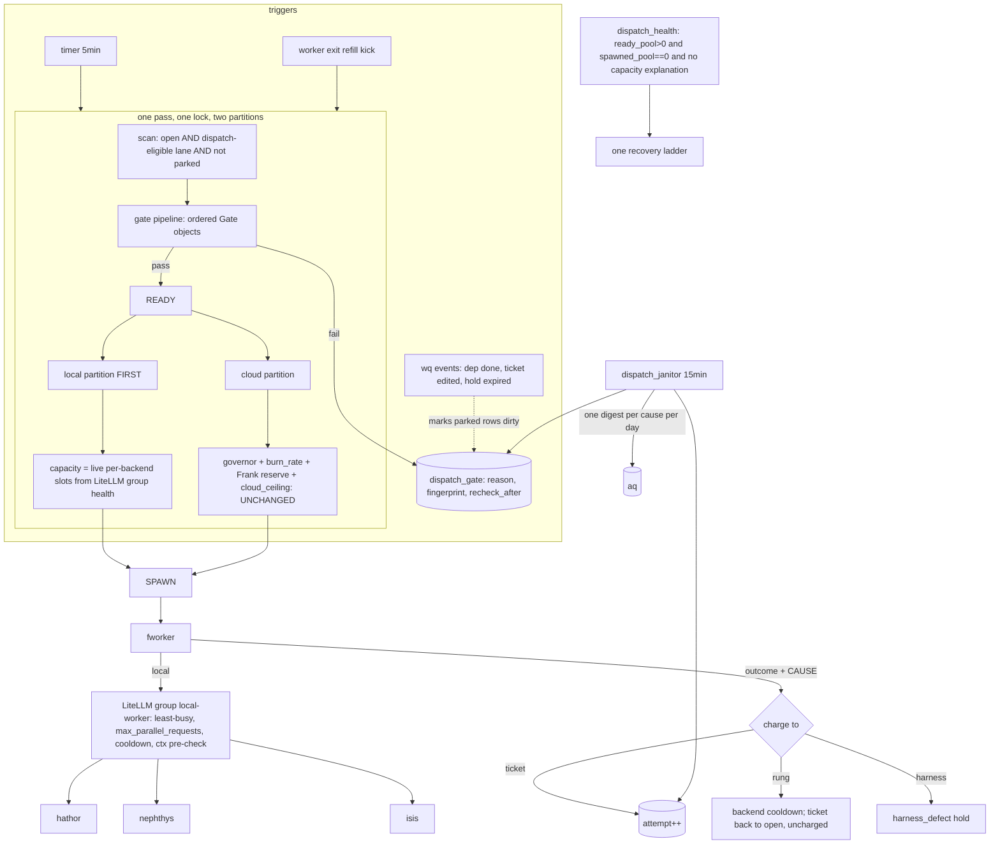

# DISPATCH_REBUILD_SPEC — implementation spec for a fresh agent (Phase 3 of 3)

orch-dispatch-dissect-62c4e5 · 2026-09-20. Read `DISPATCH_DISSECTION.md` (flaws F1-F9, all file:line)
and `DISPATCH_FIX_RESEARCH.md` (designs S1-S7) first. This document is executable on its own, but
VERIFY before you build: line numbers are against foreman HEAD `46d57cb`; re-grep if HEAD moved.

Ground rules for the implementer (fleet discipline, not optional):
- `lumen_episode.py precheck "<plan>"` before each step; `lumen_episode.py commit` after each.
- Code changes go through `lumen-pr` worktrees and land by PR. Never edit the primary tree.
  `dispatcher/config.json` is read from git HEAD (`foreman_dispatcher.py:200-220`), so an uncommitted
  edit does nothing and blocks other PRs from landing (RCA timeline, PR #676).
- Changes on the Macs and on LiteLLM are fleet state changes: run the `lumen-change-safety` gate,
  back up the file first, verify state before and after, record facts with `lumen_state.py ingest`.
- No reboots. Hathor's power policy is "up only when working": leave it up while it has slots in
  the group; do not power-manage it from this project.
- Each step below has its own PROOF. Do not start step N+1 until step N's proof passes.

## 1. Target architecture

Prose. One pass, one lock, two partitions stays (it works; DISSECTION 3.2, 8). Four things change
around it: (1) the local rung is made able to finish work and is sized by real backend slots;
(2) failures carry a cause and only ticket-caused failures cost the ticket anything; (3) gates are
objects and a gated ticket is PARKED with a reason instead of re-derived every five minutes;
(4) health is computed from `ready`, never from a list of reason strings.

### 1.1 Gate dispositions

| gate (skip_reason) | disposition | detail |
|--------------------|-------------|--------|
| kill_switch, psi deny/tight | KEEP | unchanged |
| lane_cap | KEEP | park with `recheck_after` = next UTC midnight |
| frank_gated (human lane) | MOVE | to scan: human lanes never become candidates. Marker / decision-gate variants KEEP, parked, dirty on `frank_response` change |
| lane_unmapped, repo_mismatch, route_unassigned, bad_archetype | KEEP + remediate | park terminal; janitor auto-relanes when the title carries an unambiguous repo marker (`router.title_repo_marker`), else digest |
| capability: secret denies + sweep hit | KEEP, fail-closed | add basename denies `.fleet_pw`, `.git-credentials*`, `.netrc`, `*.pw` |
| capability: dir not in allow.read_dirs, path missing, worktree mention, home-root non-secret file | FIX to advisory | dispatch; write `needs_advisory` note; no ntfy |
| capability: v2 verb | FIX | hard only inside fenced code / an imperative step line; prose mention = advisory |
| cited_path_unreachable, node_unknown (capability.preflight) | KEEP + wq#2184 | node_unknown and an explicit `needs` dir that cannot be reached stay hard. A cited path the lint classed advisory (above) is skipped by preflight at both walls (dispatcher enforce, fworker spawn) via `advisory_paths`; `FOREMAN_CAPABILITY_ADVISORY=off` restores the hold at both |
| runaway_stuck | FIX | ticket-charged attempts only, 7-day window, reset when model or archetype changes |
| harness_defect_hold | KEEP + fix | ignore a failure.json older than the ticket's last model/archetype/needs edit |
| spawn_loop | FIX | second trip inside 24 h sets status blocked, reason `SPAWN_LOOP: <last release note>` |
| nodispatch, held, deps_unmet, fire_*, already_running | KEEP | parked with the natural recheck event |
| local_slots_full | FIX | per-backend slots |
| governor_deny, burn-rate, pacing, no_slots, tight spawn cap | KEEP | byte-for-byte; add a regression test that a local ticket never reaches `_admit_cloud` |

## 2. File-by-file change map

### 2.1 `dispatcher/` (the 22 files)

| file | change | why |
|------|--------|-----|
| `foreman_dispatcher.py` | (a) new `gates.py` import; `_gate_candidate` becomes a loop over an ordered `GATES` list; each gate returns `Pass` or `Fail(reason, detail, terminal, recheck_after, fingerprint_inputs)`. (b) delete `STRUCTURAL_SKIP_REASONS`, `count_structural_skips`, `dispatchable_unpooled`; `dispatchable_<pool> = len(ready[pool]) - lane_capped[pool]`; keep a top-level `dispatchable` = their sum for old readers. (c) `scan_candidates` skips `HUMAN_LANES` and tickets with a fresh `dispatch_gate` row. (d) `_admit_local` asks `local_capacity.free_slots(model)`; (e) move `handle_stale_preflight`'s reprove ladder out of the lock: on stale stamp, skip the repo this pass, release, then run the reprove after `slock_release` in the same process. (f) `--dry-run` takes no lock. (g) `enforce_capability` honours the new `Derived.advisory` bucket. | F5, F6, F7, F8, lock hygiene |
| `gates.py` (NEW) | the Gate protocol + one small class per existing stage, order preserved exactly as DISSECTION 2.2 | legibility, metrics by construction |
| `gate_store.py` (NEW) | `dispatch_gate` table in queue.db (create-if-missing, WAL, own short transactions, 5 s busy timeout, fail-open: any sqlite error = treat as not parked). API: `park`, `unpark`, `is_parked(ticket, fingerprint)`, `due()`, `by_reason()` | F8 |
| `local_capacity.py` (NEW) | reads a `local_backends` block from config.json (`model -> {health_url, slots, served_ctx}`), probes health once per pass (2 s), returns free slots = slots - running units pinned/routed to that model; a backend that fails the probe or is in `runtime/backend_cooldown.json` has 0 slots | F5 |
| `dispatch_janitor.py` (NEW) + `systemd/lumen-foreman-janitor.{service,timer}` (15 min, ships disabled like the others) | (1) release `blocked` tickets whose failure cause = RUNG once the backend is healthy; (2) auto-relane on unambiguous title repo marker; (3) clear stale harness holds; (4) spawn_loop second-trip block; (5) one aq digest row per cause per day listing parked tickets; never touches secrets-denied tickets | F3, F8, F9, noise |
| `runaway.py` | `stuck_ticket_ids` counts only attempt files whose `charged_to` is `ticket` (absent field = ticket, for history), inside `RUNAWAY_WINDOW_DAYS=7`, and only attempts newer than the ticket's last model/archetype edit | F3 |
| `self_heal.py` | `classify_block` learns `RUNG_FAULT:` prefix; release rule mirrors INFRA_CRASH but keyed on backend health, not age. `attempt_count` gains `charged_only=True` | F3 |
| `spawn_loop_guard.py` | `looping()` returns `trips_24h`; dispatcher/janitor block on the second | F9 |
| `circuit_breaker.py` | window computed per pool (`attempt.model` via `concurrency.is_local_model`); cloud trip = today's behaviour (DISARM); local trip = write `runtime/local_pause.json` with a 60 min expiry, read by `_run_partition("local")` | pool isolation |
| `dispatch_health.py` | `_pool_stalls` drops the `unpooled` branch; legacy fallback stays for old log lines only | F7 |
| `dispatch_recover.py` | rung 1: run `harness-preflight --all` DETACHED via lumen-run and check the stamp on the next tick instead of a 40 s foreground call; rung 2: `systemctl start --no-block` | ladder that can succeed |
| `uncharge_attempt.py` | add `--cause rung` bulk mode: `--model-prefix`, `--classification HANG`, `--turns 0` (used once in step 9) | F3 recovery |
| `capability_replay.py` | print the advisory bucket too | tooling parity |
| `dispatch_config_lint.py` | FAIL when an enabled non-human lane has no `LANE_REPO` and no ticket-level repo hint support; validate `local_backends` | F8 data defects |
| `dashboard_data.py`, `dashboard.py` | read `dispatch_gate.by_reason()`; show per-backend slots | visibility |
| `config.json` | add `local_backends`; `local_ceiling` becomes an upper clamp only; drop nothing | F5 |
| `burn_rate.py`, `pacing.py`, `pacing_config.json`, `psi_pressure.py`, `observed_burn_core.py`, `observed_burn_writer.py`, `notify_sinks.py`, `vlogs_mirror.py` | NO CHANGE | budget + PSI protection must survive untouched. (Ops: either install `lumen-foreman-burnrate.timer` from `dispatcher/systemd/` or delete the writer; Frank's call, not part of this build.) |
| `state.json` | no schema change; `capability_ntfy` stops growing because advisory skips no longer page | - |
| `systemd/` | commit the live `fast-burn.conf` as `lumen-foreman-dispatch.timer.d/fast-burn.conf` and fix INSTALL.md (5 min); add janitor units | drift |

### 2.2 Outside `dispatcher/` (required, the root causes live here)

| file | change |
|------|--------|
| `harness/fworker.py` | (a) `FIRST_FRAME_TIMEOUT_S`: cloud 240; local from `local_backends[model].first_frame_s` passed by the dispatcher via env, default 1500. `INACTIVITY_TIMEOUT_S` applies only after the first frame. (b) every attempt record gains `charged_to: ticket|rung|harness|budget` and `failure_cause`; rule table in FIX_RESEARCH 2.2. (c) `handle_failure`: `charged_to == rung` = release, do not count toward `MAX_ATTEMPTS`, prefix `RUNG_FAULT:` if it still ends blocked, and append the backend to `runtime/backend_cooldown.json` (15 min, doubling to 2 h). (d) local prompt profile: `harness/prompts/local_*.md` slim templates, static prefix first; assert rendered prompt tokens (chars/3.5) <= 0.6 x served_ctx else refuse the spawn as HARNESS (uncharged). |
| `harness/capability_lint.py` | `Derived` gains `advisory`; `_derive_dirs`: deny-list hits stay `refused`; not-in-allow, missing path, own/other worktree mention, home-root non-secret file go to `advisory`; add the new basename denies BEFORE `normalise_dir`; `_derive_v2`: hard only when the match is inside a fenced block or on a line starting with a list marker/imperative verb, else advisory |
| `harness/concurrency.py` | `LOCAL_POOL_MODELS` read from models.yaml pools (`local` only); `deepseek-v4-flash` becomes its own `cheap_cloud` class: exempt from Anthropic gates (unchanged) but NOT counted in Mac slots |
| `orchestrator/router.py` | `select`/`candidates` skip rungs whose model status is not `LIVE*` or whose backend is cooling down; add `simpill` to `LANE_REPO` or disable the lane (Frank: which repo) |
| `research/models.yaml` | served-ctx truth for the three local models; routing rows: `mechanical-edit: [local-worker@local, sonnet-5@low]`, `probe-build: [local-worker@local, sonnet-5@medium, haiku-4-5]`, `standard-engineering: [sonnet-5@high, ...]` unchanged at first, with a config flag `local_standard_engineering: false` to flip after step 10's measurements; `qwen36-local` leaves the primary slot until Isis is back and serving >= 32k |
| `/home/lumen/agent/litellm_config.yaml` (LiteLLM, backup first) | model group `local-worker` with one deployment per Mac, `max_parallel_requests` = slots, `model_info.max_input_tokens` = served ctx; `router_settings: routing_strategy: least-busy, allowed_fails: 2, cooldown_time: 900, enable_pre_call_checks: true`; add `local-worker` to the scoped `foreman-local-rung` key. Keep the three per-host names for pins. |
| each Mac, ollama unit drop-in (backup first) | `OLLAMA_CONTEXT_LENGTH=32768`, `OLLAMA_NUM_PARALLEL=2`, `OLLAMA_KEEP_ALIVE=2h`, `OLLAMA_MAX_LOADED_MODELS=1`; restart ollama only (no reboot); verify `/api/ps context_length` |
| `/home/lumen/bin/dispatch-watchdog.py` + its timer | retire after step 8 proves dispatch_health covers it (disable timer, keep file); ONE stall path |

## 3. Implementation sequence (each step independently verifiable)

Order is by leverage and by dependency: the rung first (nothing else matters until one local attempt
can finish), then accounting, then capacity and routing, then the gates, then state and metric.

| # | step | touches | PROOF (must pass before the next step) |
|---|------|---------|----------------------------------------|
| 0 | Baseline snapshot: last pass counts by reason; `blocked` by class; `/api/ps` on each Mac; warm `ttft.py` at 2k/8k/16k per Mac (run one at a time, model resident) | nothing | numbers recorded in the PR description; eval tok/s per box known |
| 1 | Bring Isis back or formally drop it from the group (it is unreachable on tailnet AND LAN as of 09-20 14:20 UTC; smart plug p1 exists per lumen_state, power actions are Frank-gated) | ops | `curl 100.100.129.24:8095/health` answers, or models.yaml marks it out |
| 2 | Mac serving config (ollama drop-ins), one box at a time | hathor, nephthys, (isis) | `/api/ps` shows `context_length >= 32768`; warm 16k-token `ttft.py` returns a first token; record tok/s via `lumen_state.py ingest` |
| 3 | LiteLLM `local-worker` group + router settings | litellm_config.yaml (backup, restart container, verify healthy) | 4 parallel `ttft.py` calls against `local-worker` through the gateway land 2+2 across two Macs (check each Mac's `/api/ps` and load); a 40k-token request is refused by the pre-call check, not truncated |
| 4 | fworker: first-frame timeout, `charged_to`, rung-fault release, cooldown file, slim local prompt + size assertion | harness/fworker.py, prompts, tests | unit tests; then ONE hand-pinned mechanical-edit ticket on `local-worker` runs to a terminal verdict with `turns > 0`. If it fails, the attempt record says whose fault. |
| 5 | runaway / self_heal / uncharge cause-awareness | dispatcher/runaway.py, self_heal.py, uncharge_attempt.py | tests: a ticket with 5 rung-charged attempts is NOT stuck; with 5 ticket-charged IS; existing tests green |
| 6 | `local_capacity.py` + `_admit_local` + config `local_backends`; per-pool circuit breaker | dispatcher | tests: capacity 0 when probe fails; never admits more than slots; local breaker trip leaves cloud running and writes no DISARM |
| 7 | capability lint advisory split + new basename denies | harness/capability_lint.py, dispatcher enforce, capability_replay | `capability_replay.py` over all 44 currently-held tickets: the secret set (wq#1466, 1467, 1491, 1619, 1975, 2114, 2120) stays refused; the `/home/lumen/agent|minerva|langfuse...` set lands dispatchable-with-advisory. Attach the before/after table to the PR. |
| 8 | Gate objects, `dispatchable = len(ready)`, health rule, recover ladder timeouts, dry-run lockless, reprove outside the lock | dispatcher | replay test: feed today's 120-ticket fixture, assert identical skip reasons per ticket as the old pipeline (golden file from `dispatcher.log` pass `fdisp-20260920T141053Z-4161920`) except the step-7 advisories; `pass_end.dispatchable == len(ready)`; dispatch_health reports healthy on an all-gated queue |
| 9 | One-time recovery: `uncharge_attempt.py --cause rung` for local HANG/turns=0 records; janitor releases the `UNKNOWN: HANG` local blocks (22) in batches no larger than live slots x 2 | queue data (back up queue.db first: restic + file copy) | released tickets appear as ready in the next pass; none are re-blocked as HANG turns=0 |
| 10 | Routing rows + status/cooldown-aware `router.select`; `wq` lane/repo validation; `simpill` decision | router.py, models.yaml, bin/wq | `router.py route mechanical-edit` returns `local-worker`; with all backends cooled down it returns sonnet-5@low |
| 11 | `gate_store` parking + janitor timer + digest; retire `dispatch-watchdog`; commit timer drop-in | dispatcher, systemd | per-pass evaluated candidates drops from ~120 to the unparked set; one aq digest row per cause; editing a parked ticket makes it re-evaluated on the next pass (fingerprint test) |
| 12 | Acceptance run (section 4) | - | section 4 passes for 6 continuous hours |

Steps 4-8 and 10-11 are code PRs and can be built in parallel worktrees by separate agents (4, 5+6,
7, 8 touch disjoint files except `foreman_dispatcher.py`: land 6, then 7, then 8 in that order to
avoid conflicts). Steps 1-3 and 9 are serial ops steps.

## 4. Acceptance test: prove the Macs saturate and keep flowing

Setup: at least 3 x (live local slots) ungated local-eligible tickets (pin `--model local-worker`, or
rely on step 10 routing). Small, real mechanical-edit / probe-build tickets, not synthetic no-ops.

| check | how | pass criterion |
|-------|-----|----------------|
| A. fill | one timer pass | `spawned_local == min(ready_local, free_slots)`; `local_slots_full > 0` only if ready exceeded slots |
| B. saturation | every 5 min for 6 h: each Mac's `/api/ps` (models resident), `uptime` load, LiteLLM SpendLogs request count per deployment | while `ready_local > 0`: running local units == total live slots in >= 90 % of samples; each Mac's 5-min load > 12 (of 24 threads); per-deployment request counts within 2x of each other (least-busy is balancing) |
| C. flow | same window | every worker exit is followed by a local spawn within 2 passes (refill kick + timer); zero manual `slock release`, zero manual `wq release`; zero `lock_busy` streaks > 1 |
| D. outcomes | `_runs/*/attempt-*.json` for the window | zero `HANG` with `turns == 0` charged to a ticket; local SUCCESS+DEGRADED_SUCCESS rate reported honestly, whatever it is; every local diff got its sonnet verify ticket |
| E. gates still gate | seed 5 canaries: cites `/home/lumen/.secrets/x.token`; cites `/home/lumen/agent/.env`; `[FRANK GATE]` title; unmet dep; fleet-fires without probe | none spawn; reasons are `capability_denied_by_policy` x2, `frank_gated`, `deps_unmet`, `fire_no_probe` |
| F. accidental blockers gone | seed 3: prose-mentions `/home/lumen/minerva`; mentions the word for a privileged verb inside "do NOT ..."; cites `/home/lumen/HANDOFF.md` | all three spawn, each with a `needs_advisory` note |
| G. budget protection intact | force governor `tight` (test env: `FOREMAN_STATE_JSON` fixture at 90 % weekly) on a dry-run | cloud partition shows the burn-rate ceiling / `no_slots`; local partition unaffected; a local ticket never logs a `budget` stage event |
| H. drain behaviour | let the local-eligible pool empty | running local units fall to 0; `pass_end.dispatchable_local == 0`; dispatch_health = healthy; NO stall page, NO ladder run |
| I. backend loss | stop ollama on one Mac for 10 min (announce it; restore and confirm after) | its slots drop to 0 within one pass; in-flight tickets on it come back `open`, `charged_to: rung`, attempt count unchanged; they finish on another Mac |

Success = B and C hold for as long as ungated local work exists, and H shows the only reason the Macs
go idle is "no ungated local work", stated plainly in `pass_end` and the janitor digest.

## 5. What must not break

1. Anthropic budget protection: `router.governor_pressure`, `burn_rate.*` (incl. Frank reserve and
   `frank_active`), `cloud_ceiling`, tight-mode clamp, pacing seam. No edits; test G guards it.
2. Secret protection: `DIR_DENY_PREFIXES`, `DIR_DENY_BASENAME_GLOBS`, `DIR_DENY_PATH_GLOBS`, the
   secret sweep and its 48 h fail-closed staleness rule. Step 7 only ADDS denies and moves NON-deny
   findings to advisory. fworker's own spawn-time `capability.preflight` stays as the second wall.
3. Frank gates, fire approval + no-probe rule, holds, deps, nodispatch markers.
4. Kill switches (DISARM / STOP) and PSI deny, for both partitions.
5. `verify_pass.local_author_always`: local work is still PR-only behind a sonnet verify.
6. Config-from-git-HEAD and fail-soft lanes; single-instance lock with SIGTERM release and
   dead-holder steal; per-ticket quarantine boundaries; atomic state writes.
7. The decision log's one-line-per-decision property (`test_every_decision_logged`): parked tickets
   log once when parked and once when unparked, not every pass; keep the event names.
8. Rollback levers, one per step: `FOREMAN_NEEDS_LINT_MODE=warn` (exists), new
   `FOREMAN_GATE_STORE=off`, `FOREMAN_LOCAL_CAPACITY=static` (falls back to `local_ceiling`),
   `FOREMAN_CHARGE_MODE=legacy`. Each new behaviour ships behind its lever, default on.

## 6. Open decisions for Frank (do not block steps 0-8)

- Isis: power-cycle via plug p1 and return it to the group, or leave it out.
- `simpill` lane: which repo, or disable the lane.
- `local_standard_engineering`: flip after step 0/2 tok/s numbers; recommended only if warm eval
  >= 40 tok/s or the slim prompt lands under 6k tokens.
- `pilot` `max_per_day: 3`: 16 pilot tickets are queued behind it (5+ days of backlog at 3/day).
- burnrate timer: install or delete.
